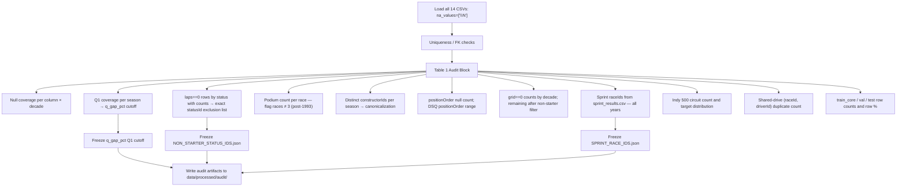
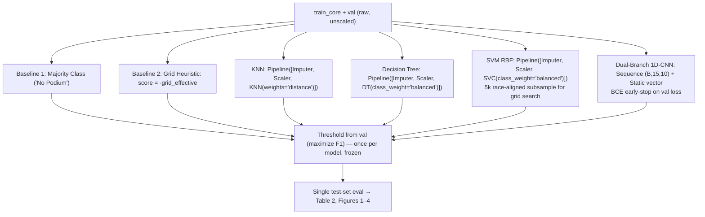
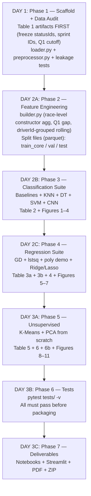

# Formula 1 End-to-End Machine Learning Engineering Suite
## DEFINITIVE Master Implementation Plan & Technical Specification
### Version 5.0 — Final Authority Document

**Author**: Pair Programming Team (User & AI)
**Academic Target**: IIIT Sri City ML Assignment (Deadline: October 31, 2026)
**Portfolio Target**: Production-Grade, Resume-Worthy Full-Stack ML Engineering
**Dataset**: Kaggle F1 World Championship (1950–2024, Rohan Rao / Ergast DB)
**Local Cache**: `C:\Users\hamiz\.cache\kagglehub\datasets\rohanrao\formula-1-world-championship-1950-2020\versions\24`

---

## SECTION 0: Change Register v4.0 → v5.0

Two expert reviews were incorporated. See `v5_change_register.md` for the full accept/reject reasoning for each of the 35 proposed changes. Summary of accepted changes:

| ID | What Changed | Why |
|---|---|---|
| **R-E1** | **Supervised scope = 1994–2024 only** | 1950–1993 has shared-drive rows that produce 4–7 podium labels in 18 races (corrupted classification target). Qualifying data also only starts 1994. Career K-Means retains full 1950–2024 history. |
| **R-E2** | **Split: train_val_pool=1994–2018, test=2019–2024 (season-aligned)** | "80th-percentile date" produced 83%/17% rows, not 80/20, because field sizes vary by era. Season-aligned end-of-2018 boundary gives ≈79.3%/20.7% and satisfies assignment. |
| **R-E3** | **Final sklearn models refit on `train_val_pool` after freezing** | "Train on train_core only" gave the grader a 70%-trained model, not 80%. CNN exception: stays on train_core (val is the early-stop signal). |
| **R-E4** | **Race-level cumulative constructor features** | Plain `.shift(1)` on driver rows leaks within-race data when teammates share a race. Must aggregate to `(raceId, constructor)` level first, shift one race, then join back. |
| **R-E5** | **`q_gap_pct` = Q1-relative only** | Comparing Q1-eliminated drivers to Q3 pole time confounds pace with session selection. Use Q1 gap to Q1 fastest only. Add `quali_position_norm` as a separate ordinal feature. |
| **R-E6** | **Sprint `grid_vs_quali_delta` = NaN for all sprint weekends from 2021 onward** | 2023–2024 also have sprint weekends (6 each). Sprint raceIds identified from `sprint_results.csv`, not hardcoded year ranges. |
| **R-E7** | **CNN early stop on val BCE loss, not val F1** | Early stopping on val F1 requires a threshold, which is also tuned on val — circular. Early stop on loss; sweep threshold once after training. |
| **R-E8** | **`race_time_folds()` returns positional indices via `np.flatnonzero`** | sklearn GridSearchCV expects positional indices. Non-default DataFrame index produces misalignment. |
| **R-E9** | **`positionOrder` target confirmed complete; audit checks added** | `positionOrder` has zero nulls (while `position` has 10,953). Audit adds DSQ row checks and Indy 500 identification. |
| **R-E10** | **Feature whitelist replaces blacklist** | Blacklists miss newly derived columns. `ALLOWED_FEATURES` set enforced with assertion in tests. |
| **R-E11** | **`grid_zero_flag` instead of `pit_lane_start`** | R1 confirms: after non-starter exclusion, 110 zero-grid rows remain and not all are pit-lane starts. Renamed to `grid_zero_flag`; `grid_effective` is still computed as worse-than-last. |
| **R-E12** | **Complexity Figure 4 uses train vs val, never test** | Test set must be touched exactly once. Validation curves are used for overfitting analysis. |
| **R-E13** | **SVM threshold swept over quantiles of decision scores** | `decision_function()` is unbounded; sweeping [0.1, 0.9] as probabilities is meaningless for SVM. |
| **R-E14** | **SVM 5k subsample is race-aligned** | Row slice can split a race. Select whole races backward from end of train_core until ~5k rows. |
| **R-E15** | **GD parity: relative tolerance** | `J_GD - J_lstsq < 1e-3` is absolute; breaks as target scale changes. Use relative: `< 1e-6 * max(1.0, |J_lstsq|)`. |
| **R-E16** | **Constructor `pts_share` Round 1 rule clarified** | v4.0 was contradictory. Rule: Round 1 → prior-season final share if existed, else 0.0 + `new_constructor_flag`. |
| **R-E17** | **`teammate_form_delta` uses mean of ALL other drivers on constructor** | Historic teams had >2 drivers per race. Arbitrary pairwise join is wrong. |
| **R-E18** | **CIFAR-10 removed; standard datasets for ALL three questions** | Both reviews flag CIFAR-10 vs digits contradiction. Resolved: `load_digits` (Q1), `load_diabetes` (Q2), `load_iris` (Q3). |
| **R-E19** | **Rolling features grouped by `driverId` before rolling** | Plain `.shift(1).rolling()` without `groupby(driverId)` crosses driver boundaries. |
| **R-E20** | **Q1 outlier detection: flag times > 150% of median for circuit-era** | R1 cites real data error: Mark Blundell 1995 Japanese GP Q1 = `16:42.640`. Parser must flag impossible times. |
| **R-E21** | **`EXPERIMENT_FREEZE.yaml` written before any test prediction** | Prevents iterative model revision using test-set feedback. |
| **R-E22** | **New test: one row per `(raceId, driverId)` after cleaning** | Shared drives produce duplicate keys; assert uniqueness post-cleaning. |
| **R-E23** | **New test: constructor features identical for all teammates within a race** | Validates that race-level aggregation works correctly. |
| **R-E24** | **CNN static-only MLP ablation noted as sub-experiment** | CNN has more info than classical models (temporal sequence). MLP ablation measures the sequence branch's incremental value. |

---

## 1. System Architecture & Directory Blueprint

```
d:/ML-Project/
├── FINAL_IMPLEMENTATION_PLAN.md    # This document (v5.0)
├── CODING_STANDARDS.md             # PEP 8, type hints, NumPy-docstring, ML standards
├── MEMORY.md                       # Persistent decision log (v5.0 current)
├── README.md                       # Resume-grade presentation
├── pyproject.toml
├── requirements.txt
│
├── data/
│   ├── raw/                        # 14 F1 CSVs from kagglehub cache
│   └── processed/
│       ├── audit/                  # Table 1 artifacts (JSON/CSV) — frozen before feature code
│       │   ├── table1_audit.csv
│       │   ├── non_starter_status_ids.json
│       │   ├── sprint_race_ids.json
│       │   ├── q_coverage_by_season.csv
│       │   ├── constructor_canonical_map.json
│       │   └── feature_registry.csv
│       ├── train_core.parquet
│       ├── val.parquet
│       ├── test.parquet
│       └── career_clustering.parquet
│
├── src/
│   ├── __init__.py
│   ├── data/
│   │   ├── loader.py               # na_values=\N; dtype assertions; uniqueness checks
│   │   └── preprocessor.py         # race_time_folds(); three-set split; EXPERIMENT_FREEZE.yaml
│   ├── features/
│   │   └── builder.py              # All pre-race features; race-level constructor agg; Q1 gap
│   ├── models/
│   │   ├── classifiers.py          # Pipeline([Imputer, Scaler, Model]) for KNN/Tree/SVM
│   │   ├── cnn_classifier.py       # Dual-branch 1D-CNN + static-only MLP ablation
│   │   ├── linear_gd.py            # Scratch GD; lstsq parity; analytically-derived alpha
│   │   ├── polynomial_reg.py       # Degree sweep on [-1,1] scaled continuous feature
│   │   ├── regularized_reg.py      # Ridge & Lasso on degree-2 expansion
│   │   ├── kmeans_scratch.py       # Career-level clustering; k-means++ restarts
│   │   └── pca_scratch.py          # Covariance + eigh; full loading matrix
│   ├── evaluation/
│   │   ├── classification_metrics.py  # Metrics; bootstrap_auc_ci(); threshold sweeps
│   │   └── regression_metrics.py      # MSE/RMSE/R² all-starters + classified-only
│   └── visualization/
│       └── plots.py                # 11 figures at 300 DPI
│
├── notebooks/
│   ├── 01_data_audit_and_eda.ipynb
│   ├── 02_classification_benchmarks.ipynb
│   ├── 03_regression_overfitting.ipynb
│   ├── 04_unsupervised_kmeans_pca.ipynb
│   ├── appendix_A_digits_classification.ipynb    # load_digits: KNN/Tree/SVM/2D-CNN
│   ├── appendix_B_diabetes_regression.ipynb      # load_diabetes: OLS/Ridge/Lasso
│   └── appendix_C_iris_clustering_pca.ipynb      # load_iris: K-Means/PCA
│
├── tests/
│   ├── test_pipeline_integrity.py
│   ├── test_linear_gd.py
│   ├── test_kmeans_scratch.py
│   └── test_pca_scratch.py
│
├── app/
│   └── streamlit_app.py
│
└── reports/
    ├── figures/
    ├── generate_report.py
    └── final_assignment_report.pdf
```

---

## 2. Non-Negotiable Design Commitments (v5.0)

1. **Supervised scope = 1994–2024**. Pre-1994 data has shared-drive label corruption and no qualifying data. Used only for career K-Means clustering (documented survivorship caveat).
2. **Season-aligned 80/20 split**: train_val_pool = 1994–2018, test = 2019–2024. Reported as race count and row percentage.
3. **Three-set protocol**: `train_core` (1994–2016) / `val` (2017–2018) / `test` (2019–2024). Final sklearn models refit on `train_val_pool` after freezing. CNN stays on `train_core`.
4. **Race-level cumulative features**: constructor stats aggregated to `(raceId, constructor)` level, shifted one race, then joined back to driver rows.
5. **Q1-only qualifying gap**: `q_gap_pct` = Q1 driver time vs Q1 fastest. Outliers (>150% median) flagged as NaN. `quali_position_norm` kept as separate ordinal.
6. **Sprint mask covers all sprint years**: All raceIds in `sprint_results.csv` get `grid_vs_quali_delta = NaN`.
7. **CNN early stop on val BCE loss**. Threshold swept once on val after training stops.
8. **`race_time_folds()` returns positional indices** via `np.flatnonzero` on reset-index arrays.
9. **Feature whitelist enforced** with assertion test. No forbidden column can enter any model's feature matrix.
10. **Rolling features grouped by `driverId`** before `.shift(1).rolling()`.
11. **`EXPERIMENT_FREEZE.yaml` written** before any `predict(X_test)` call.
12. **Standard dataset appendices for all three questions** (digits, diabetes, iris). CIFAR-10 removed.

---

## 3. Data Ingestion, Audit & Pre-Race Feature Engineering (Pipeline 0)

### 3.0 Mandatory Audit — Table 1 Must Be Produced Before Feature Code Is Frozen



### 3.1 Loader (`loader.py`) — Fixed Behaviours

```python
# Every CSV loaded with:
df = pd.read_csv(path, na_values=[r"\N"])

# Dtype validation (use pandas API, not raw numpy dtype):
from pandas.api.types import is_numeric_dtype
assert is_numeric_dtype(df["positionOrder"]), "positionOrder not numeric — \\N not parsed"
assert is_numeric_dtype(df["grid"]), "grid not numeric"

# Referential integrity:
assert results.groupby(["raceId", "driverId"]).size().max() == 1, \
    "Duplicate (raceId, driverId) detected — shared drives not yet collapsed"
assert set(results["statusId"]).issubset(set(status["statusId"]))

# Supervised scope filter (applied AFTER audit of shared-drive rows):
SUPERVISED_START_YEAR = 1994  # qualifying data starts; shared drives end
df_supervised = df[df["year"] >= SUPERVISED_START_YEAR]

# Non-starter exclusion — exact statusIds from Table 1 audit artifact:
import json
NON_STARTER_STATUS_IDS = set(json.load(open("data/processed/audit/non_starter_status_ids.json")))
df_starters = df_supervised[~df_supervised["statusId"].isin(NON_STARTER_STATUS_IDS)]
# laps == 0 is NOT a filter — first-lap crashers are real starters

# grid == 0 handling — not unambiguously "pit lane start" per R1:
df_starters["grid_zero_flag"] = (df_starters["grid"] == 0).astype(int)
field_proxy = (
    df_starters.groupby("year")["grid"]
    .transform(lambda s: s.replace(0, float("nan")).max())
)
df_starters["grid_effective"] = df_starters["grid"].where(
    df_starters["grid"] > 0,
    field_proxy.fillna(df_starters["grid"].replace(0, float("nan")).max()) + 1
)

# Canonical constructor mapping: by constructorId + year range
CONSTRUCTOR_CANONICAL: dict[tuple, str] = {
    # (constructorId, year_start, year_end): canonical_id
    # Populated from audit; covers Force India→Racing Point→Aston Martin,
    # Toro Rosso→AlphaTauri→RB, Renault/Lotus F1/Alpine, Sauber/Alfa Romeo,
    # Brawn→Mercedes (2009→2010+)
    # Team Lotus (1958–1994) kept SEPARATE from Lotus F1 (2012–2015)
}
```

### 3.2 Feature Engineering (`builder.py`) — Complete Specification

**Prediction timestamp**: After final starting grid is known, before race start.
Permitted inputs: `results.grid`, qualifying lap times, any data from races before this one.
Forbidden inputs: lap times, pit stops, race points, final status, fastest lap, milliseconds.

#### Pre-Race Feature Table

| Feature | Formula (exact) | NaN/Missing Rule | Leakage-safe? |
|---|---|---|---|
| `grid_effective` | `grid` if >0, else `field_max_that_season + 1` | Never NaN for starters | ✅ Grid known at race start |
| `grid_zero_flag` | `(grid == 0).astype(int)` | Always defined | ✅ |
| `grid_norm` | `grid_effective / grid_effective.groupby(raceId).max()` | Never NaN | ✅ |
| `norm_finish` | `(positionOrder - 1) / max(num_starters - 1, 1)` | For PAST races only (feature input) | ✅ Past race outcome |
| `driver_norm_finish_p5` | `groupby(driverId)[norm_finish].transform(lambda s: s.shift(1).rolling(5, min_periods=3).mean())` | NaN if <3 prior races | ✅ Shift(1) guarantees past-only |
| `driver_dnf_rate_p5` | `groupby(driverId)[is_dnf].transform(lambda s: s.shift(1).rolling(5, min_periods=3).mean())` | NaN if <3 prior races | ✅ |
| `driver_podium_rate_career` | `groupby(driverId)[is_podium].transform(lambda s: s.shift(1).expanding().mean())` | NaN at career start | ✅ |
| `is_rookie_window` | `groupby(driverId)['started'].transform(lambda s: s.shift(1).expanding().sum()) < 3` | Always defined | ✅ |
| `q_gap_pct` | `(q1_seconds - raceId.min(q1_seconds)) / raceId.min(q1_seconds) * 100`; outliers >150% median flagged NaN | NaN if no Q1 time or outlier | ✅ Qualifying before race |
| `q1_data_available` | 1 if Q1 time not null and not outlier, else 0 | Always defined | ✅ |
| `quali_position_norm` | `qualifying.position / num_qualifiers_in_race` | NaN if no qualifying row | ✅ |
| `grid_vs_quali_delta` | `grid_effective - qualifying.position` | NaN for all sprint raceIds (from sprint_results.csv 2021+); NaN if no qualifying row | ✅ |
| `teammate_form_delta` | `driver_norm_finish_p5 - mean(norm_finish_p5 of all other drivers, same canonical constructor, same race)` | NaN if no teammate history | ✅ Teammate's prior races only |
| `constructor_pts_share` | See Section 3.3 below | 0 or prior-season share at round 1 | ✅ Race-level agg, shifted |
| `constructor_season_rank` | Rank by cumsum constructor points after prior round | Rank 1 = most points | ✅ |
| `rounds_completed` | `round - 1` | Always defined | ✅ |
| `driver_age_years` | `(race_date - dob).dt.days / 365.25` | Rarely NaN | ✅ |
| `new_constructor_flag` | 1 if constructor has no prior-season entries in canonical map | Always defined | ✅ |

**Feature whitelist (enforced by assertion)**:
```python
ALLOWED_FEATURES = {
    "grid_effective", "grid_norm", "grid_zero_flag",
    "q_gap_pct", "q1_data_available", "quali_position_norm",
    "grid_vs_quali_delta",
    "driver_norm_finish_p5", "driver_dnf_rate_p5",
    "driver_podium_rate_career", "is_rookie_window",
    "teammate_form_delta",
    "constructor_pts_share", "constructor_season_rank",
    "rounds_completed", "driver_age_years", "new_constructor_flag",
    # Imputer indicators generated dynamically: must match "missing_*" pattern
}
FORBIDDEN_FEATURES = {
    "position", "positionOrder", "positionText", "points", "laps",
    "time", "milliseconds", "fastestLapTime", "fastestRank",
    "fastestLapSpeed", "statusId", "status", "raceId", "driverId",
    "constructorId", "date", "number", "url",
}
```

### 3.3 Race-Level Constructor Feature (Critical Anti-Leakage Logic)

```python
# Step 1: Aggregate to one row per (raceId, canonical_constructor_id)
constructor_race = (
    df_starters
    .groupby(["year", "raceId", "race_order", "canonical_constructor_id"])
    .agg(
        race_pts=("points", "sum"),
        n_drivers=("driverId", "nunique"),
    )
    .reset_index()
    .sort_values(["canonical_constructor_id", "year", "race_order"])
)

# Step 2: Cumulative sum shifted by one race (race-level, not row-level)
constructor_race["pts_cumsum_before_race"] = (
    constructor_race
    .groupby(["canonical_constructor_id", "year"])["race_pts"]
    .cumsum()
    .shift(1)         # shift(1) here means "previous race" — no within-race leakage
    .fillna(0)
)

# At round 1, fall back to prior season's final cumsum share
# (see loader.py: prior_season_final_share lookup table)

# Step 3: Max points available per race (observed from results, not theoretical)
max_pts_per_race = (
    df_starters
    .groupby("raceId")["points"]
    .max()
    .rename("max_pts_available")
)
# Step 4: Share = cumsum_before_race / cumsum_max_pts_before_race
# Step 5: Join back to driver rows on (raceId, canonical_constructor_id)
# All drivers on same constructor in same race get IDENTICAL constructor_pts_share
```

**Test**: `assert df.groupby(['raceId','canonical_constructor_id'])['constructor_pts_share'].nunique().max() == 1`

### 3.4 Q1 Gap with Outlier Protection

```python
import re

def parse_q1_time(s: str | None) -> float | None:
    """Parse 'm:ss.sss' or 'ss.sss' to total seconds. Returns None if invalid."""
    if pd.isna(s):
        return None
    match = re.fullmatch(r"(\d+):(\d{2}\.\d+)", str(s))
    if match:
        return int(match.group(1)) * 60 + float(match.group(2))
    match = re.fullmatch(r"(\d+\.\d+)", str(s))
    if match:
        return float(match.group(1))
    return None  # malformed

qualifying["q1_seconds"] = qualifying["q1"].apply(parse_q1_time)

# Outlier detection: flag times > 150% of median for (circuitId, decade)
qualifying["decade"] = (qualifying["year"] // 10) * 10
medians = (
    qualifying
    .groupby(["circuitId", "decade"])["q1_seconds"]
    .transform("median")
)
qualifying["q1_outlier"] = qualifying["q1_seconds"] > (1.5 * medians)
qualifying.loc[qualifying["q1_outlier"], "q1_seconds"] = None  # treat as missing

# Gap relative to fastest valid Q1 in that race:
race_q1_best = qualifying.groupby("raceId")["q1_seconds"].transform("min")
qualifying["q_gap_pct"] = (
    (qualifying["q1_seconds"] - race_q1_best) / race_q1_best * 100
)
```

### 3.5 Three-Set Temporal Protocol

```
All supervised races: 1994–2024 (sorted by year, round)
│
├── train_core  ─ 1994–2016 seasons
│   ├── Used for: GridSearchCV with race_time_folds()
│   ├── Preprocessing (imputer/scaler) fitted here
│   └── Model training
│
├── val         ─ 2017–2018 seasons
│   ├── Used for: CNN early stopping (BCE loss)
│   ├── Threshold sweep (maximize F1) for ALL classifiers — once, after training
│   └── NOT used for any hyperparameter selection
│
└── test        ─ 2019–2024 seasons
    └── Touched ONCE after EXPERIMENT_FREEZE.yaml is written

train_val_pool = train_core ∪ val
Final sklearn model refit: pipeline.fit(X_train_val_pool, y_train_val_pool)
CNN final model: stays on train_core (val is the early-stop anchor)
```

**Table 1 must report**:
- train_core: N races, N rows, % of total rows
- val: N races, N rows, % of total rows
- test: N races, N rows, % of total rows
- train_val_pool: N races, N rows, % of total rows (must be ≈80%)

### 3.6 Race-Aligned CV Fold Generator

```python
import numpy as np
import pandas as pd

def race_time_folds(
    df: pd.DataFrame,
    n_val_seasons: int = 8,
) -> list[tuple[np.ndarray, np.ndarray]]:
    """
    Return positional train/val index pairs (no race straddles boundary).

    Args:
        df: DataFrame with 'year' column, RESET INDEX (call df.reset_index(drop=True) first).
        n_val_seasons: Number of most-recent seasons in train_core used as val folds.

    Returns:
        List of (train_positional_idx, val_positional_idx) tuples for GridSearchCV cv= arg.
    """
    df = df.reset_index(drop=True)   # guarantee positional alignment
    years = df["year"].to_numpy()
    seasons = np.unique(years)
    val_seasons = seasons[-n_val_seasons:]

    folds: list[tuple[np.ndarray, np.ndarray]] = []
    for val_year in val_seasons:
        train_idx = np.flatnonzero(years < val_year)
        val_idx   = np.flatnonzero(years == val_year)
        if train_idx.size > 0 and val_idx.size > 0:
            folds.append((train_idx, val_idx))
    return folds
```

---

## 4. Mini-Project 1: Classification Suite

**Target**: `y_podium = 1` if `positionOrder <= 3` and driver is classified finisher, else 0.
**Scope**: Supervised 1994–2024 starters only. Podium rate ≈15%.



### 4.1 Pipeline Specification

```python
from sklearn.pipeline import Pipeline
from sklearn.preprocessing import StandardScaler
from sklearn.impute import SimpleImputer

imputer = SimpleImputer(strategy="median", add_indicator=True)

# KNN
knn_pipe = Pipeline([
    ("imputer", SimpleImputer(strategy="median", add_indicator=True)),
    ("scaler", StandardScaler()),
    ("knn", KNeighborsClassifier(weights="distance")),
])
knn_grid = GridSearchCV(
    knn_pipe, {"knn__n_neighbors": range(1, 31)},
    cv=race_time_folds(df_train_core.reset_index(drop=True)),
    scoring="roc_auc",
)

# Decision Tree
dt_pipe = Pipeline([
    ("imputer", SimpleImputer(strategy="median", add_indicator=True)),
    ("scaler", StandardScaler()),
    ("dt", DecisionTreeClassifier(class_weight="balanced", random_state=42)),
])
dt_grid = GridSearchCV(
    dt_pipe,
    {"dt__max_depth": range(1, 21), "dt__ccp_alpha": [0, 0.001, 0.01, 0.1]},
    cv=race_time_folds(df_train_core.reset_index(drop=True)),
    scoring="roc_auc",
)

# SVM — race-aligned subsample for grid search (whole races, newest ~5k rows)
# After grid search: refit full pipeline on train_val_pool
svm_pipe = Pipeline([
    ("imputer", SimpleImputer(strategy="median", add_indicator=True)),
    ("scaler", StandardScaler()),
    ("svm", SVC(kernel="rbf", class_weight="balanced",
                probability=False, random_state=42)),
])
svm_grid = GridSearchCV(
    svm_pipe,
    {"svm__C": [0.1, 1, 10, 100],
     "svm__gamma": [0.001, 0.01, 0.1, "scale"]},
    cv=race_time_folds(df_subsample_5k.reset_index(drop=True)),
    scoring="roc_auc",
)
```

### 4.2 SVM Threshold (Decision-Function Based)

```python
# SVM produces decision_function scores, not probabilities
val_scores = svm_pipe.decision_function(X_val)
thresholds = np.quantile(val_scores, np.linspace(0.01, 0.99, 199))
f1_scores  = [f1_score(y_val, val_scores >= t) for t in thresholds]
svm_threshold = thresholds[np.argmax(f1_scores)]
# Store in EXPERIMENT_FREEZE.yaml before test evaluation
```

### 4.3 Dual-Branch 1D-CNN

```
Sequence features (15 per prior race, last 10 prior races per driver):
  1.  norm_finish              (positionOrder-1)/(num_starters-1)
  2.  is_dnf                   1 if DNF, 0 if classified
  3.  grid_norm                grid_effective / max_grid_that_race
  4.  grid_zero_flag           1 if original grid==0
  5.  q_gap_pct                Q1 gap (NaN→0 + mask channel)
  6.  q1_data_available        1 if Q1 time valid
  7.  quali_position_norm      qualifying.position / num_qualifiers
  8.  grid_vs_quali_delta      (NaN→0 + mask channel)
  9.  driver_dnf_rate_p5       rolling DNF rate prior 5 races
  10. constructor_pts_share    race-level agg, shifted
  11. constructor_season_rank  shifted
  12. rounds_completed         round - 1
  13. driver_age_years         years at race date
  14. is_rookie_window         <3 prior races flag
  15. mask_channel             1 for real prior race, 0 for left-padding

Sequence input shape: (batch=32, channels=15, seq_len=10)
Left-pad with zeros if driver has <10 prior races

Branch A (Temporal):
  Conv1d(15, 32, kernel_size=3, padding=1) → BatchNorm1d(32) → ReLU
  → MaxPool1d(2)
  → Conv1d(32, 64, kernel_size=3, padding=1) → BatchNorm1d(64) → ReLU
  → AdaptiveAvgPool1d(1) → Flatten → [64-dim]

Static features: same imputed+scaled vector as KNN/Tree/SVM
Branch B (Static):
  Linear(n_static, 32) → ReLU → [32-dim]

Merge:
  cat([64-dim, 32-dim]) → Linear(96, 32) → ReLU → Dropout(0.3)
  → Linear(32, 1)

Loss:   BCEWithLogitsLoss(pos_weight=min(n_neg/n_pos, 20.0))
Early stop: patience=10 on val BCE loss (NOT val F1)
Threshold: swept on val once after training, frozen in EXPERIMENT_FREEZE.yaml
Seeds:  torch.manual_seed(42), np.random.seed(42), random.seed(42)
        torch.backends.cudnn.deterministic=True
        torch.backends.cudnn.benchmark=False

Ablation (sub-experiment, not in Table 2 main ranking):
  Static-only MLP: Linear(n_static,64)→ReLU→Dropout(0.3)→Linear(64,1)
  Report MLP vs CNN AUC to isolate the value of the sequence branch.
```

### 4.4 Classification Evaluation

**Table 2** — models evaluated on `test` with threshold from `val`:

| Model | Threshold | Acc | Prec | Rec | F1 | ROC-AUC [95% CI] | PR-AUC |
|---|---|---|---|---|---|---|---|
| Majority Class | n/a | ~85% | 0.00 | 0.00 | 0.00 | 0.50 | ~15% |
| Grid Heuristic | from val | TBD | TBD | TBD | TBD | TBD [CI] | TBD |
| KNN | from val | TBD | TBD | TBD | TBD | TBD [CI] | TBD |
| Decision Tree | from val | TBD | TBD | TBD | TBD | TBD [CI] | TBD |
| SVM (RBF) | from val | TBD | TBD | TBD | TBD | TBD [CI] | TBD |
| Dual-Branch 1D-CNN | from val | TBD | TBD | TBD | TBD | TBD [CI] | TBD |

Bootstrap: 1,000 draws resampling **races** (all drivers in a race move together). Handle degenerate draws (single class) by redrawing; report effective draw count. Paired AUC differences reported. If 95% CIs overlap, report "no statistically significant winner."

**Figure 4 — Four-Panel Complexity Curves (train vs val, NOT test)**:
1. KNN val AUC vs K (1..30)
2. Decision Tree train vs **val** accuracy vs max_depth (1..20)
3. 1D-CNN train vs val BCE loss per epoch (early-stop marker)
4. SVM validation-score heatmap over C × γ

---

## 5. Mini-Project 2: Regression Suite

### 5.0 Single Regression Target — Definitive Statement

> **`positionOrder` for all starters (supervised scope 1994–2024).** Confirmed complete (zero nulls). DNF results already rank at back by the Ergast positionOrder convention. No sentinel. No gap-to-winner. No milliseconds.
>
> **Robustness row in Table 3a**: R² recomputed on classified-finishers-only subpopulation to characterize DNF noise.

### 5.1 Scratch Gradient Descent

```python
# Preprocessing: impute → scale → add intercept column
# All done on train_core only (same imputer/scaler as classifiers)
X_train_gd = np.column_stack([np.ones(n), X_train_scaled])

# Stability analysis
lambda_max  = np.linalg.eigvalsh(X_train_gd.T @ X_train_gd / n).max()
alpha_safe  = 0.8 * (2.0 / lambda_max)   # converges smoothly
alpha_unsafe = 2.2 * (2.0 / lambda_max)  # diverges demonstrably
# Note: alpha depends only on X, not on the target choice

# Convergence correctness test (relative tolerance):
theta_gd    = gradient_descent(X_train_gd, y_train, alpha=alpha_safe, n_iter=10_000)
theta_lstsq, _, _, _ = np.linalg.lstsq(X_train_gd, y_train, rcond=None)
J_gd    = (1 / (2*n)) * np.sum((X_train_gd @ theta_gd - y_train)**2)
J_lstsq = (1 / (2*n)) * np.sum((X_train_gd @ theta_lstsq - y_train)**2)
relative_excess = (J_gd - J_lstsq) / max(1.0, abs(J_lstsq))
assert relative_excess < 1e-6, f"GD did not converge: relative excess = {relative_excess:.2e}"
```

### 5.2 Table 3a — Main Regression Benchmark

All models fitted on `train_val_pool`, evaluated once on `test`:

| Model | Key Params | Train MSE | Test MSE | Test RMSE | Test R² | Classified-Only R² |
|---|---|---|---|---|---|---|
| Predict-mean Baseline | — | TBD | TBD | TBD | ~0.00 | TBD |
| Grid-only OLS | `positionOrder ~ grid_effective` | TBD | TBD | TBD | TBD | TBD |
| OLS (lstsq) | all features | TBD | TBD | TBD | TBD | TBD |
| GD Linear Reg | α_safe, 10k iter | TBD | TBD | TBD | TBD | TBD |
| Ridge | optimal α from CV | TBD | TBD | TBD | TBD | TBD |
| Lasso | optimal α from CV | TBD | TBD | TBD | TBD | TBD |

### 5.3 Table 3b — Polynomial Demo (Controlled Subsample, Separate From Table 3a)

- **Purpose**: pedagogical bias-variance demonstration ONLY. Never mixed with Table 3a.
- **Subsample**: 60 rows from `train_core` (2000–2005), fixed by whole races; 20 held-out rows from same era.
- **Feature**: `grid_effective` scaled to [-1, 1].
- **Degrees**: {1, 2, 3, 5, 8, 10, 12} via `np.polynomial.Polynomial.fit`.
- **Report**: actual observed shape — do not pre-write expected text.

### 5.4 Ridge & Lasso

```python
continuous_features = [
    "grid_effective", "driver_norm_finish_p5", "driver_dnf_rate_p5",
    "q_gap_pct", "teammate_form_delta", "constructor_pts_share",
    "driver_age_years", "quali_position_norm", "rounds_completed",
]
binary_flags = [
    "grid_zero_flag", "q1_data_available", "is_rookie_window",
    "new_constructor_flag",
]

# Pipeline: Imputer → Scaler → PolynomialFeatures(degree=2) on continuous only
#           → passthrough binary → Ridge/Lasso
# All inside GridSearchCV(cv=race_time_folds(...))
alphas = np.logspace(-4, 2, 30)
```

---

## 6. Mini-Project 3a: K-Means Clustering from Scratch

### 6.0 Unit of Analysis

**One row per driver career. Minimum 20 total starts (1950–2024 history).**
K-Means uses the FULL history (not supervised-scope-restricted). Survivorship caveat documented.
Expected population: ~300–600 drivers (verify in audit).

### 6.1 Era-Robust Feature Set

| Feature | Formula | Why Era-Robust |
|---|---|---|
| `win_share` | `total_wins / total_starts` | Calendar-independent |
| `podium_share` | `total_podiums / total_starts` | Calendar-independent |
| `pts_share` | `mean(race_pts / max_pts_observed_that_race)` over career | Per-race normalization handles scoring rule changes |
| `norm_avg_finish` | `mean((positionOrder-1)/max(num_starters-1,1))` over career | Field-size normalized |
| `dnf_adj` | `mean(is_dnf - race_dnf_rate)` per career start | Adjusts for era reliability shifts |
| `teammate_delta` | `mean(norm_finish - mean_teammate_norm_finish)` over shared constructor starts | Car-independent driver skill |

Pre-clustering transforms: apply `log1p` to right-skewed features (`win_share`, `podium_share`, `pts_share`). Compare with rank transform using silhouette score; choose and report both, freeze one.

### 6.2 Algorithm

```python
for K in range(2, 7):
    best_wcss = np.inf
    for trial in range(15):   # 15 k-means++ restarts
        labels, wcss = KMeansScratch(K, init="kmeans++", random_state=trial).fit(X_std)
        if wcss < best_wcss:
            best_wcss, best_labels = wcss, labels
    wcss_results[K] = best_wcss
    silhouette_results[K] = silhouette_score(X_std, best_labels)

# Parity test only: shared centroid init, single run, lloyd, tol=0
rng = np.random.default_rng(42)
centroids_init = X_std[rng.choice(len(X_std), K_optimal, replace=False)]
scratch_labels, scratch_wcss = KMeansScratch(
    K_optimal, init=centroids_init, tol=0, max_iter=1000).fit(X_std)
sklearn_labels = KMeans(
    K_optimal, init=centroids_init, n_init=1,
    algorithm="lloyd", tol=0, max_iter=1000, random_state=42).fit_predict(X_std)
# WCSS parity within 1e-4; labels up to permutation
```

Empty-cluster rule: reassign centroid to point farthest from its assigned centroid. Parity only claimed for runs where no cluster empties (test separately).

### 6.3 Cluster Names

Inspect centroid coordinates AFTER choosing K. Names assigned empirically from centroid values, never pre-written.

---

## 7. Mini-Project 3b: PCA from Scratch

### 7.1 Mathematical Pipeline

```python
# Same standardized matrix as K-Means
Sigma = (1 / (n - 1)) * X_std.T @ X_std   # sample covariance

eigenvalues, eigenvectors = np.linalg.eigh(Sigma)   # guaranteed real for symmetric
# eigh returns ASCENDING order — reverse:
idx = np.argsort(eigenvalues)[::-1]
eigenvalues  = eigenvalues[idx]
eigenvectors = eigenvectors[:, idx]

# Clamp near-zero negative eigenvalues caused by floating-point:
assert all(eigenvalues[eigenvalues < 0] > -1e-10), "Unexpected large negative eigenvalue"
eigenvalues = np.clip(eigenvalues, 0, None)

EVR = eigenvalues / eigenvalues.sum()
Z_2D = X_std @ eigenvectors[:, :2]

# Sign convention (makes loadings interpretable):
for i in range(eigenvectors.shape[1]):
    if eigenvectors[np.abs(eigenvectors[:, i]).argmax(), i] < 0:
        eigenvectors[:, i] *= -1

# Sign alignment vs sklearn for parity test (sign-correct THEN compare):
```

### 7.2 Table 6 — Full Eigenvalue Spectrum

Report all PCs (not just 3), since feature count is only 6:

| PC | Eigenvalue (λ) | EVR (%) | Cumulative EVR (%) |
|---|---|---|---|
| 1 | TBD | TBD | TBD |
| ... | | | |

### 7.3 Table 6b — Full Eigenvector Loading Matrix (All 6 PCs × 6 Features)

Values to 3 decimal places. Mandatory per brief 3b(i). Sign convention applied.

---

## 8. Master Table & Figure Catalog

### Tables

| ID | Name | Key Contents |
|---|---|---|
| **Table 1** | Data Audit | Null coverage × decade; Q1 coverage × season; `laps==0` by status; podium count × race; constructorIds × season; shared-drive duplicate count; `positionOrder` completeness; DSQ counts; `grid==0` after filtering; split row counts & percentages |
| **Table 2** | Classification Benchmark | 6 models × {Acc, Prec, Rec, F1, ROC-AUC [95%CI], PR-AUC, Threshold, Best Hyperparams} |
| **Table 3a** | Regression Benchmark | 6 models × {Train MSE, Test MSE, RMSE, R² all-starters, R² classified-only, Key Params} |
| **Table 3b** | Polynomial Demo | 7 degrees × {Train MSE, Held-out MSE, Observed behaviour} |
| **Table 4** | Regularization Sparsity | Degree-2 features × {OLS min-norm coeff, Ridge coeff, Lasso coeff, Lasso zeroed?} |
| **Table 5** | K-Means WCSS & Silhouette | K=2..6 × {Scratch WCSS (best of 15), Sklearn WCSS (parity), Silhouette, Cluster names} |
| **Table 6** | PCA Eigenvalue Spectrum | All PCs × {λ, EVR%, Cumulative EVR%} |
| **Table 6b** | PCA Loading Matrix | All 6 features × All 6 PCs (3 d.p.) |
| **App. Table A** | `load_digits` Benchmark | KNN+Tree+SVM+2D-CNN: Acc, macro-F1, OvR ROC-AUC |
| **App. Table B** | `load_diabetes` Benchmark | OLS/Ridge/Lasso: MSE, RMSE, R² |
| **App. Table C** | `load_iris` Benchmark | K-Means (K=2,3,4) + PCA: Silhouette, EVR%, loading signs |

### Figures (300 DPI)

| File | Contents |
|---|---|
| `fig1_confusion_matrices.png` | 2×2 quad-panel (KNN/Tree/SVM/CNN); TP/FP/TN/FN + threshold + 1-sentence interpretation |
| `fig2_roc_curves.png` | All 4 classifiers + 2 baselines; AUC with 95% CI in legend; random-guess line |
| `fig3_pr_curves.png` | PR curves all classifiers; no-skill baseline at actual podium rate |
| `fig4_complexity_curves.png` | **4 panels**: KNN val AUC vs K; DT train+val accuracy vs depth; CNN train+val BCE loss; SVM heatmap C×γ |
| `fig5_gd_convergence.png` | J(θ) vs iteration: α_safe (convergence) + α_unsafe (divergence); threshold marked |
| `fig6_poly_bias_variance.png` | Train MSE + held-out MSE vs degree; actual observed shape |
| `fig7_regularization_cv_paths.png` | Ridge CV-MSE vs log(α); Lasso CV-MSE vs log(α); optimal α marked |
| `fig8_kmeans_elbow_silhouette.png` | Dual y-axis: WCSS + Silhouette vs K=2..6 |
| `fig9_pca_2d_clusters.png` | PC1 vs PC2; colored by K-Means labels; feature loading arrows |
| `fig10_pca_scree.png` | Scree: individual EVR bars + cumulative EVR line; 2-PC and 3-PC markers |
| `fig11_pca_3d.png` | 3D scatter PC1 vs PC2 vs PC3 (supplementary) |

---

## 9. Automated Test Suite

| Test File | Checks |
|---|---|
| `test_pipeline_integrity.py` | `\N` → NaN confirmed; unique `(raceId, driverId)` post-cleaning; `races.date.unique()` monotonic (not row-level); shift(1) future-perturbation test (race N results perturbed → race N-1 features unchanged); whitelist assertion (FORBIDDEN_FEATURES absent from X); constructor pre-race feature identical for all teammates in same race; sprint raceIds coverage matches sprint_results.csv count; no raceId in >1 of train_core/val/test |
| `test_linear_gd.py` | Relative excess `(J_GD - J_lstsq) / max(1.0, |J_lstsq|) < 1e-6`; α_unsafe diverges within 50 iterations (J increases from J_0); α_safe and α_unsafe derived from λ_max of X only |
| `test_kmeans_scratch.py` | WCSS parity within 1e-4 (shared centroids, lloyd, tol=0); label parity up to permutation; empty-cluster rule triggers + recovers on synthetic fixture (parity only claimed for no-empty-cluster runs) |
| `test_pca_scratch.py` | Eigenvalues match sklearn within 1e-6 (sign-corrected); EVR sums to 1.0; 2D projection matches sklearn (sign-corrected); no unexpected large negative eigenvalues |
| **New** `test_grid_encoding.py` | `grid_effective > 0` for all starters; `grid_zero_flag == 1` iff original grid == 0; `grid_effective` for zero-grid rows > max non-zero grid in that season |
| **New** `test_qualifying_parser.py` | `parse_q1_time` correctly handles `m:ss.sss` and `ss.sss`; outlier flagging (Blundell-style 16:xx time rejected); Q1 gap is non-negative; pole driver has gap = 0 |
| **New** `test_race_folds.py` | Positional indices are in-bounds; train/val sets disjoint; `max(train_years) < min(val_years)`; no raceId straddles boundary |

---

## 10. EXPERIMENT_FREEZE.yaml Policy

Write this file **before calling `pipeline.predict(X_test)` for any model**:

```yaml
# EXPERIMENT_FREEZE.yaml — written once, never modified
freeze_timestamp: "2026-10-30T..."
supervised_scope: "1994-2024"
train_val_pool_boundary: "last race of 2018"
test_boundary: "first race of 2019"
feature_set_hash: "<sha256(sorted(ALLOWED_FEATURES))>"

hyperparameters:
  knn: {n_neighbors: TBD}
  dt:  {max_depth: TBD, ccp_alpha: TBD}
  svm: {C: TBD, gamma: TBD}
  ridge: {alpha: TBD}
  lasso: {alpha: TBD}

thresholds:
  knn: TBD        # from val F1 sweep
  dt:  TBD
  svm: TBD        # from val decision-function quantile sweep
  cnn: TBD

random_seeds:
  numpy: 42
  torch: 42
  sklearn_random_state: 42

cnn_stopped_epoch: TBD
```

---

## 11. Standard Dataset Compliance Appendices

Because the assignment brief says "use a standard dataset," all three questions are replicated on textbook datasets in separate appendix notebooks:

| Appendix | Dataset | Covers |
|---|---|---|
| **Appendix A** | `sklearn.datasets.load_digits` (10-class, 64 features) | Q1 classification: KNN, Decision Tree, SVM, 2D-CNN (reshape to `(N,1,8,8)`) |
| **Appendix B** | `sklearn.datasets.load_diabetes` (regression, 10 features) | Q2 regression: OLS, Ridge, Lasso (GD + polynomial are in main F1 section) |
| **Appendix C** | `sklearn.datasets.load_iris` (4 features, 3 classes) | Q3: K-Means K=2,3,4; PCA with full loading matrix |

Report structure: "Main case study: Formula 1. Required assignment compliance: Appendix A/B/C." CIFAR-10 removed entirely.

---

## 12. Phased Execution Roadmap (3-Day Sprint)



### Phase 1 Checklist
- [ ] Create full directory tree
- [ ] Copy CSVs to `data/raw/`
- [ ] `loader.py`: `na_values=[r"\N"]`, dtype assertions, uniqueness checks, supervised scope filter
- [ ] Run `01_data_audit_and_eda.ipynb` → produce all Table 1 outputs
- [ ] Write `data/processed/audit/` JSON/CSV artifacts
- [ ] From audit: freeze `NON_STARTER_STATUS_IDS`, `SPRINT_RACE_IDS`, Q1 cutoff rule
- [ ] Write those constants into `loader.py` and `builder.py` (read from JSON, not hardcoded)

### Phase 2 Checklist
- [ ] `builder.py`: driverId-grouped rolling features; race-level constructor agg; Q1 parser + outlier flag; sprint NaN mask from JSON; `grid_effective`/`grid_zero_flag`; teammate mean-of-others
- [ ] `preprocessor.py`: `race_time_folds()` with positional indices; season-aligned three-set split; save parquet files
- [ ] Run future-perturbation test and constructor invariance test

### Phase 7 Checklist
- [ ] `streamlit_app.py`: `@st.cache_data` for data/features, `@st.cache_resource` for model objects
- [ ] `generate_report.py` → `final_assignment_report.pdf` (ReportLab)
- [ ] `submission_code.zip`: `src/`, `notebooks/`, `tests/`, `reports/`, `requirements.txt`, `README.md`, PDF
- [ ] Do NOT include raw CSVs (too large); include `data/processed/` artifacts

---

## 13. Key Decisions Summary (v5.0 Definitive)

1. **Supervised scope**: 1994–2024
2. **Career clustering scope**: 1950–2024
3. **Regression target**: `positionOrder` (confirmed complete)
4. **Podium label**: `positionOrder <= 3` AND classified finisher; only within 1994–2024
5. **Split**: train_core=1994–2016, val=2017–2018, test=2019–2024
6. **Final sklearn refit**: on `train_val_pool` (1994–2018); CNN stays on train_core
7. **Q1 gap**: vs Q1 fastest; outliers flagged at 150% circuit-era median
8. **Sprint mask**: all raceIds in sprint_results.csv from 2021+
9. **Constructor agg**: race-level then join back (no within-race leakage)
10. **Rolling features**: `groupby(driverId)` before `.shift(1).rolling()`
11. **grid==0**: `grid_zero_flag` + `grid_effective` (not `pit_lane_start`)
12. **CNN early stop**: val BCE loss; threshold swept once post-training
13. **SVM threshold**: quantile sweep of decision_function scores
14. **GD parity tolerance**: relative `< 1e-6`
15. **Standard datasets**: digits (Q1), diabetes (Q2), iris (Q3); CIFAR-10 removed
16. **EXPERIMENT_FREEZE.yaml**: written before any test prediction
